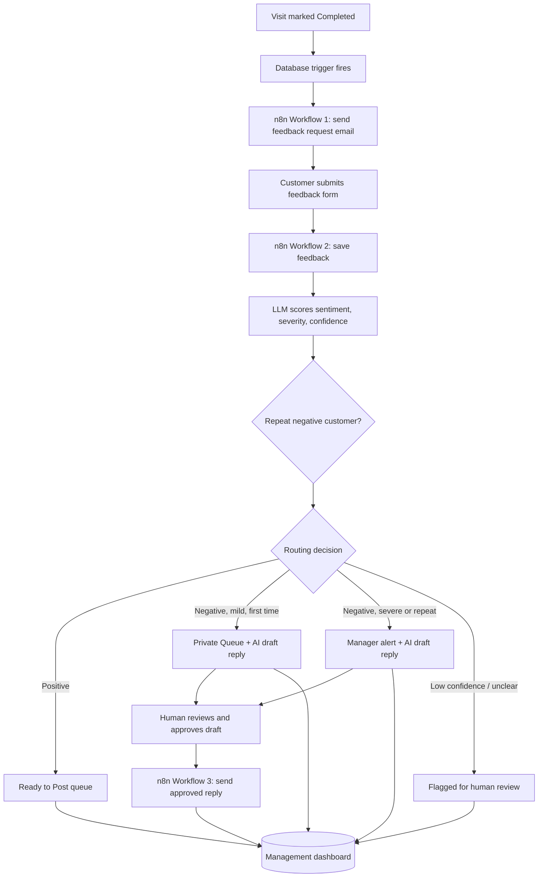

# Reputation & Feedback Intelligence Engine

> An AI-powered automation that collects customer feedback after every car-care visit, **scores how positive or negative (and how severe) it is**, routes it to the right person at the right speed, drafts a personal reply for a human to approve, and shows everything on one multi-location dashboard.

**Stack:** n8n · Supabase (PostgreSQL) · Lovable · OpenAI / Gemini (LLM) · Gmail

---

## The problem

A multi-location car care and auto repair chain does good work, but its online reputation does not show it:

- Follow-up after a visit is inconsistent and depends on who is at the front desk.
- Bad reviews appear online **before** the team hears from the customer.
- Mildly annoyed customers and furious customers are handled identically.
- Managers have no single place to see feedback across branches.

## The solution

Every completed visit becomes a feedback opportunity. The system reads what customers actually wrote, scores it on a scale instead of sorting it into two buckets, and decides what happens next based on **the score and the customer's history**, not on keywords.

---

## How it works

### The three n8n workflows

| Workflow | Trigger | Job |
|---|---|---|
| **1. Send Feedback Request** | Supabase database trigger on `visits` (status = `Completed`) | Looks up the customer, logs the request, emails a personal feedback link |
| **2. Process Feedback** | n8n Form submission | Saves feedback, scores it with an LLM, checks history, routes it, drafts replies, raises alerts |
| **3. Send Approved Reply** | Supabase trigger when a draft is set to `Approved` | Sends the human-approved reply and marks it `Sent` |

---

## AI skills demonstrated

This project is built around practical applied-AI techniques:

| Skill | How it is used here |
|---|---|
| **LLM integration in automation** | An LLM node inside n8n reads free-text customer feedback and returns structured results |
| **Prompt engineering** | Prompts that force strict JSON output, define scoring scales, and instruct the model how to behave on unclear input |
| **Structured output and parsing** | JSON responses are parsed in a Code node, with a safe fallback when the model returns something invalid |
| **Graded sentiment scoring** | Sentiment is scored from -1.0 to 1.0 and severity from 0 to 10, not a binary happy/unhappy label |
| **Confidence-aware decisions** | Low-confidence or unintelligible replies are sent to a human instead of being guessed at |
| **Rule-based routing on AI output** | Score, severity and customer history decide the route, rather than keyword matching |
| **Context-aware generation** | Draft replies reference what each customer specifically said, rather than inserting a name into a template |
| **Human-in-the-loop design** | Nothing is sent to a customer or posted publicly without human review and approval |
| **Cross-record reasoning** | A repeat-complaint check across a customer's history escalates patterns, even when one message reads mild |
| **AI-assisted development** | The dashboard was generated with Lovable (prompt-driven development) and connected to a live database |

---

## Routing logic

| Condition | Route | What happens |
|---|---|---|
| Confidence below 0.6, or unreadable | **Needs Human Review** | Alert created; no automatic routing |
| Sentiment positive | **Ready to Post** | Saved for a human to copy into a public review later |
| Negative, first time, severity below 7 | **Private Queue** | Draft reply generated; the team handles it in their own time |
| Negative and (repeat customer **or** severity 7 or above) | **Escalated to Manager** | Manager alerted immediately; draft reply generated in parallel |

Negative feedback is **never** pointed toward a public review.

---

## Dashboard

A single management view, filterable by location:

- Every piece of feedback, its location and sentiment score
- What happened to it: Ready to Post, Private Queue, or Escalated
- The queue of positive reviews ready to copy and publish
- Negative feedback alongside its AI-drafted reply and send status
- Open vs. acted alerts
- Customer and visit data entry (marking a visit `Completed` triggers the automation)

> Screenshots:
> 

---

## Database design (Supabase / PostgreSQL)

| Table | Purpose |
|---|---|
| `customers` | Customer details |
| `visits` | Visit records, location and status |
| `feedback_requests` | Log of requests sent |
| `feedback` | What customers said |
| `ai_analysis` | Sentiment, severity, confidence, repeat flag, routing state |
| `response_drafts` | AI-drafted replies and their review/sent status |
| `alerts` | Manager alerts and whether they were acted on |

---

## Demo scenarios

| Scenario | Example feedback | Result |
|---|---|---|
| Positive | "Amazing service, my car looks brand new!" | Ready to Post |
| First-time negative | "It was fine, a bit slow." | Private Queue + draft reply |
| Repeat negative | A second mild complaint from the same customer | Manager alert + draft reply |

---

Workflow Demo: https://drive.google.com/drive/folders/1mN_n6GNFwx9oXn5yvQxuqA0N_Nrhr57d?usp=drive_link

## Setup

1. **Supabase:** create a project and run the table schema in `/database/schema.sql`.
2. **n8n:** import the workflow files from `/workflows` and add credentials for Supabase, Gmail and your LLM provider.
3. **Triggers:** create the Supabase database triggers that call your n8n webhook URLs (use Production URLs once workflows are active).
4. **Dashboard:** connect the Lovable app to your Supabase project with the project URL and **anon** key.

> **Security:** never commit API keys. The Supabase `service_role` key belongs only in n8n credentials. Row Level Security policies in this demo are permissive and should be tightened (with authentication) for production use.

---

## Limitations and next steps

- No integration with a real public review platform (by design: a human posts reviews).
- Demo-level Row Level Security; production needs authentication and role-based access per branch.
- Possible improvements: SMS/WhatsApp feedback requests, multilingual feedback, and managers' alerts via WhatsApp or Slack.
